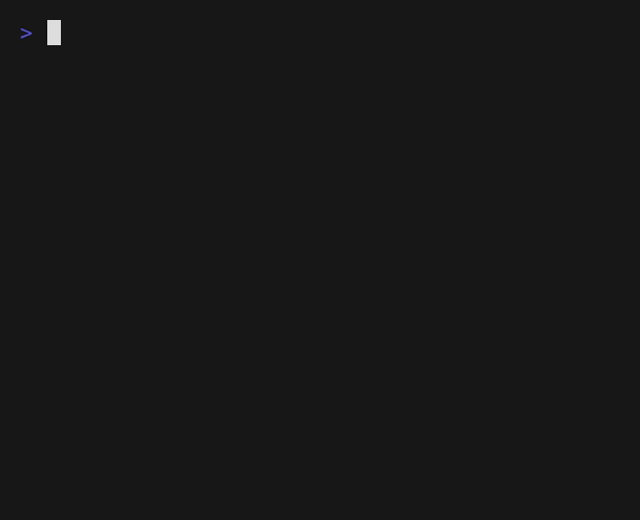

# Mario 2


# What to Do

In “Super Mario Bros.” released in 1985, toward the beginning, Mario must hop over adjacent pyramids of blocks.
In a file called `mario2.py`, implement a program that recreates that pyramid,
using `#` for bricks, as in the below:

```bash
$ python mario2.py
Height: 8
       #  #
      ##  ##
     ###  ###
    ####  ####
   #####  #####
  ######  ######
 #######  #######
########  ########
```

First, prompt the user for an `int` for the pyramid’s actual height.
The height **must** be between 2 and 10 (both included).

```bash
$ python mario2.py
Height: 4
   #  #
  ##  ##
 ###  ###
####  ####
```

Notice that the width of the “gap” between adjacent pyramids is equal to the width of two hashes, irrespective of the pyramids’ heights.

> [!TIP]
> To transform `str` into `int`, simply use `int()` ([Python ref](https://docs.python.org/3/library/functions.html#int)).

Re-prompt the user, again and again as needed, if their input is not correct.



> [!TIP]
> To check that a string (`str`) contains only digits, you may use `isdigit()`. ([Python ref](https://docs.python.org/3/library/stdtypes.html#str.isdigit))

# How to Test

Test your program from the exercise folder with:

```bash
python test_mario2.py
```

(use `python3` instead of `python` if that is how you run Python on your computer).

The script runs your program as a user would: it types some answers to the `Height: ` question, then checks what your program prints.
When a test fails, it explains what is wrong; spaces are shown as `·` so you can count them.

Don't forget it's important to test your program.
In fact, when you decide to test a program, you'll have to ask yourself questions about what your program does and what the special cases are.

What happens if the user input is :
* a negative number?
* 0 ?
* a positive number?
* a number just outside the limits?
* letters or words?
* nothing at all?

We tend to trust users' logic, but, when we write code, we have to imagine answers that don't follow any logic.

> "When you have eliminated the impossible, whatever remains, however improbable, must be the truth."
> Sherlock Holmes

# How to Submit

Once you're done with all tasks, submit all your python files on Moodle

# Licence

This course is freely inspired from [CS50’s Introduction to Computer Science](https://cs50.harvard.edu/x/2025/) Harvard. It is licensed under a [CC BY-NC-SA 4.0](https://creativecommons.org/licenses/by-nc-sa/4.0/) license.
